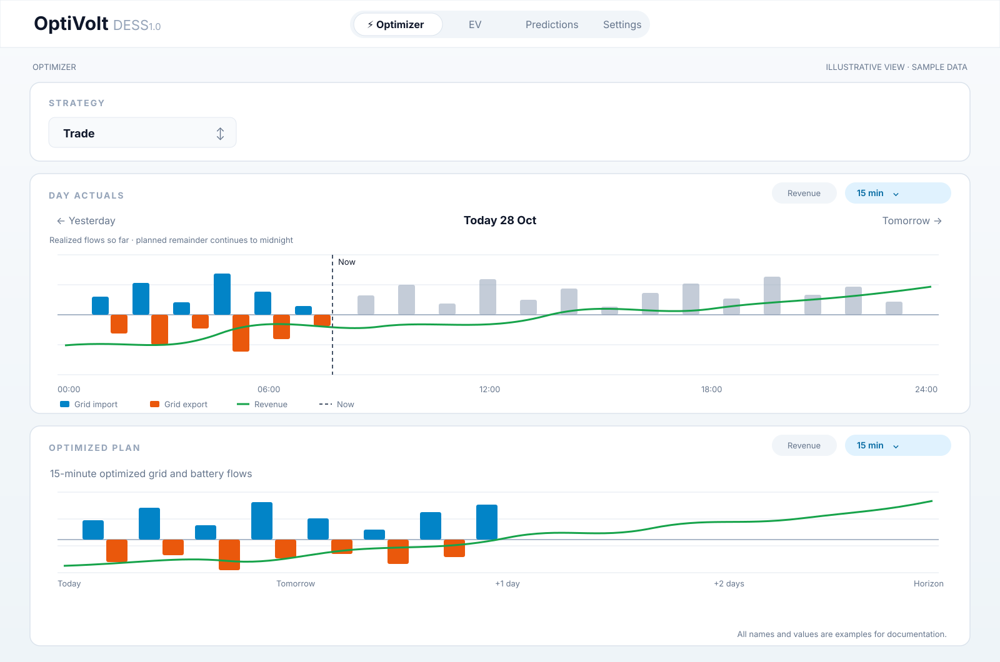
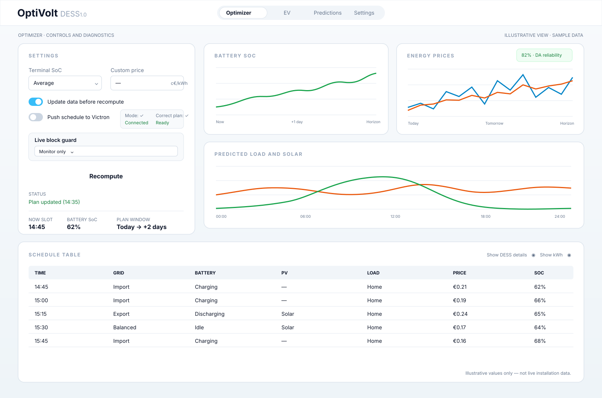
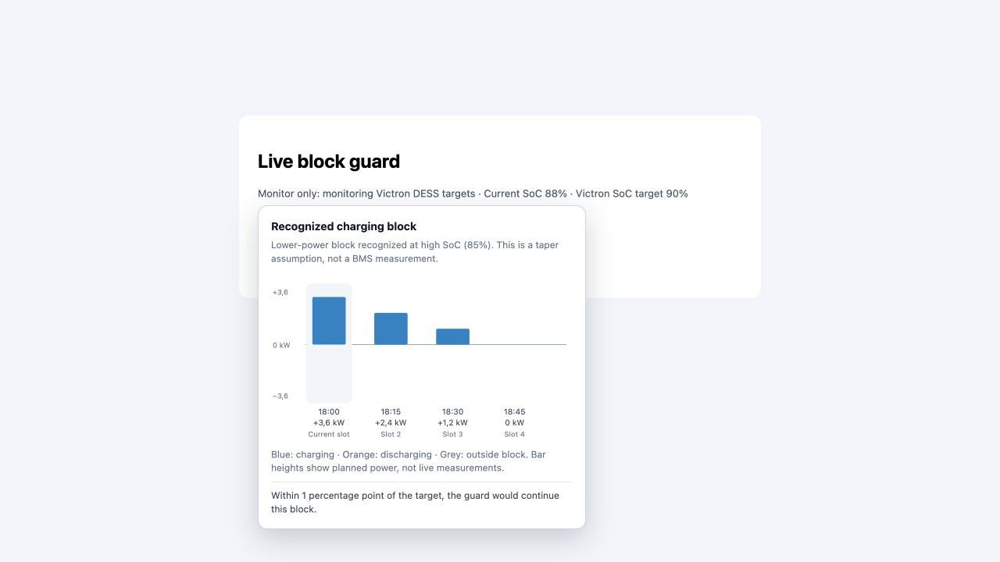

# OptiVolt 🔋

## Changes in this fork — OptiVolt DESS 1.0

This fork is based on [bmesuere/optivolt](https://github.com/bmesuere/optivolt), starting from upstream commit `410a954`. The additions below describe the local source code, including changes made on 26 October 2026. The original functionality and installation instructions appear below. Version **1.0** in the page header identifies this personal fork.

## Optimizer tab overview

The **Optimizer** tab is the main overview for planning and operating the home battery. It brings the selected strategy, measured energy flows, the optimized schedule, run controls, and supporting charts together on one page.



*Illustrative interface view. All figures and chart values are fictional examples.*

### Strategy and power-flow plans

- **Strategy:** choose the optimization strategy, such as Trade or Green.
- **Day Actuals:** review the selected day's realized power flows, with date navigation and chart controls for the time resolution and optional revenue line. The four summary tiles show Revenue, Import Cost, Export Revenue, and Battery Wear Cost. Today can include the planned remainder of the day; past dates show the selected day's stored results.
- **Optimized Plan:** inspect the calculated power-flow schedule. Choose a 15-minute or hourly view, select the planning horizon, and optionally show the cumulative revenue line. Its summary tiles use the same four measures as Day Actuals.

### Controls and diagnostics

The Settings panel contains optimizer inputs and quick settings, recompute options, and the Victron schedule-push control. The adjacent status area reports the last run, current plan summary, battery state of charge, load and solar outlook, and related diagnostics. Mode and Correct plan indicators show the detected Victron mode and whether the current plan is complete and syntactically valid for Victron. The Live block guard status is shown with its operating mode.

Battery SoC, Energy Prices (including the DA reliability · 30d indicator), and Predicted Load and Solar charts help explain the result. The Schedule Table provides the slot-by-slot plan, with display options for DESS details and energy values.



*Illustrative interface view. Example settings, status, and chart data are fictional.*

### Prices, strategies, and returns

- **All-in tariffs:** Energy tax, import surcharge, selling costs, VAT, and a net-metering option are applied centrally to API prices and price forecasts. The base price series are retained so that tariff changes can be reapplied without double counting. Tariff settings use €/kWh; price series use cents/kWh.
- **Import:** `(base price + import surcharge + energy tax) × VAT factor`. **Export:** `(base price − selling costs + any energy tax under net metering) × VAT factor`, with amounts converted to the same unit. This is the implemented calculation; enter values that match your own contract.
- **New API prices refresh the plan:** saving the settings triggers a new calculation. This automatic recalculation does not write a plan to Victron.
- **Forecasts from HTTP(S) or a local `file:` source:** the configured forecast feed can extend the horizon beyond known prices. Actual prices remain authoritative. The extended horizon itself was already present upstream.
- **Aggressive and Green:** Aggressive retains the economic optimization. Green gives additional priority to self-consumption and storing solar energy, limits grid charging above the configured maximum purchase price, and limits battery exports below the minimum selling price. Soft reserve-SoC targets around forecast solar production help bridge the night and morning; they are not unconditional guarantees.
- **Net returns in the energy chart:** an optional cumulative line showing export revenue minus import costs and calculated battery wear, with euro amounts in the tooltip. This is a planning result, not measured or billed revenue.

### Live block guard for charging and discharging

Every **60 seconds**, the guard checks the current SoC and Victron target. It examines up to the four available DESS slots and detects consecutive charging or discharging blocks. Its purpose is to prevent an intermediate SoC target from interrupting such a block too early.

- **Consistent detection in Monitor and Automatic:** both modes use the same current server plan, using a browser plan only as a preview when no current server plan is available. Missing push confirmation prevents automatic writes, but does not prevent detected blocks from being displayed.
- **Off / Monitor / Automatic:** Monitor displays suggestions only. Automatic also requires push to be enabled and the current plan to have been confirmed as sent.
- **Detection:** at least one slot in the continuous block reaches 75% of the configured power limit. This percentage is a detection threshold, not a command to charge at 75%. Lower power at the block edges may still belong to the block.
- **Tapering power:** when charging above 85% SoC or discharging below 15% SoC, blocks at lower power can also be detected. This is an SoC-based assumption, not a reading of BMS power limits.
- **Standby compensation is not charging:** charging power that only compensates for configured standby losses after efficiency is applied does not connect an idle slot to a later charging block. For example, 42.105 W at 95% efficiency compensates for about 40 W of losses and does not count as an active charging start.
- **Preview without early adjustment:** a future block visible only in slot 4 can still be displayed. The guard does not suggest a new current SoC target for it and does not write anything until the block becomes active. A single final slot is not extended when no following connected slot is available.
- **Adjust within one percentage point:** if the target could interrupt the active block, a new target is calculated from the remaining planned energy, capacity, and efficiencies, within the SoC limits. This is an SoC margin, not an exact one-minute-to-target prediction.
- **Duplicate changes are avoided**, and the relevant settings and plan are checked again before an automatic write.



*Screenshot of an isolated UI example with fictitious values. The bars show planned power: blue for charging, orange for discharging, and gray outside the block. The current slot is highlighted. The current tooltip also shows a suggested or applied new SoC target, whether increasing or decreasing it. Click the tooltip to close it; Escape also works.*

### Handoff between OptiVolt and Victron/VRM

When a plan is actually pushed, this fork first sets **Dynamic ESS mode 4 (Node-RED)** and reads the value back over MQTT. Plan slots are sent only after confirmation. Up to three read attempts are made; a failure to confirm results in an error.

When **Push to Victron** is turned off, the disabled state is saved first. OptiVolt then sets **mode 1 (Auto/VRM)** and verifies that handoff as well. The interface reports confirmation or an error. If the handoff fails, push remains disabled; saving settings again during the same server run can retry it. Plan and guard writes are serialized with the handoff so that an in-flight push cannot set mode 4 after the handoff.

Direct MQTT topics start with `W/<portal-ID>/…` for writes, `R/<portal-ID>/…` for reads, and `N/<portal-ID>/…` for responses. The mode topic is `settings/0/Settings/DynamicEss/Mode`, for example with `{"value":4}`. An additional `victron/` prefix should be used only with a bridge configured for it. Mode 4 is **Dynamic ESS**, not the general ESS External control setting.

### DA reliability: forecast error tracking

`GET /forecast-accuracy` and the **DA reliability · 30d** field show a score based on the latest 30 fully recorded delivery days, at most. These are not necessarily 30 consecutive calendar days. Only days with complete, matching quarter-hour slots are included; daylight saving time is taken into account.

The forecast stored before the complete actual prices arrived is compared with the import prices:

```text
WAPE = 100 × sum(|forecast − actual|) / sum(|actual|)
score = max(0, 100 − WAPE)
```

**An 82% score therefore means about an 18% relative total absolute price error**; it does not mean that 82% of quarter-hour values are correct or that next week is accurate with 82% confidence. If the denominator is zero, no score can be calculated. The comparison uses the stored import-price series, including the applied tariff formula. Taxes and surcharges therefore affect the scale of the score.

The hover tooltip shows the explanation and the current number of days and quarter-hour slots. Click the tooltip or press Escape to close it. Records are stored in `DATA_DIR/forecast-accuracy.json`, separately from model training in EpexPredictor.

### Interface and saved preferences

- **Update data before recompute**, **Push to Victron**, and the guard mode are saved.
- **Show DESS details**, **Show kWh**, chart range, energy-flow time resolution, and the returns line are saved on the server. Existing browser preferences can be migrated on first use.
- Changing display preferences alone does not invalidate the cached plan or start a new optimization.
- Custom layout, chart typography for small screens, tooltip styling, and a version label next to the logo.
- Local data, secrets, and temporary files are kept out of the source code through ignore rules. Enter API keys locally; do not publish personal configuration or data directories.

### Activation and verification

Backend changes require restarting the active service or container. For a standalone systemd installation using this service name, run `systemctl restart optivolt.service`. Then refresh the browser; static UI changes normally do not require a server restart.

Targeted regression tests cover block detection, standby compensation, tapering, future blocks, MQTT mode confirmation, and handoff to VRM. Run `npm run typecheck` and `npm run test:run` to check the current checkout. Forecast error tracking must establish whether linked forecasts improve in practice; this README does not claim a measured accuracy gain.


Plan and control a home energy system with forecasts, dynamic tariffs, and a day-ahead optimization pipeline. OptiVolt builds a linear program over 15-minute slots to decide how your **battery**, **PV**, **EV**, **heat pump**, and the **grid** should interact to minimize cost.

- **Primary focus:** Victron Energy ESS systems via the **Victron VRM API** and MQTT Dynamic ESS schedule writing.
- **How to run:** as a **Home Assistant App** (recommended) _or_ as a **standalone Node.js server** that serves the web UI and API from the same port.

## Features

- Day-ahead cost minimization over 15-minute slots using HiGHS (WASM)
- Built-in load forecasting based on Home Assistant historical sensor data
- Server-side VRM integration for forecasts/prices and system limits
- Optional Dynamic ESS schedule pushes over MQTT (first 4 slots)
- EV charging integration: LP-optimized schedule with departure deadline, target SoC, and per-slot charge mode classification
- Optional extended planning horizon (up to 6 extra days) with forecast prices, so multi-day EV targets ("80% in 3 days") become real constraints
- Static, build-free web UI served by the same Express process
- Persistent settings + time-series data under a configurable data directory

## Installation

### Home Assistant App (Recommended)

1. **Expose the add-on directory over Samba:**
   Install the Samba share App in Home Assistant and configure it so the `/addons` directory is available as a network share. Mount that share on your computer. Apps used to be add-ons in Home Assistant, this has been changed in the ui but not yet on the file system, so this directory is called addons.
2. **Copy the Optivolt files:**
   Copy the contents of your local Optivolt repository into the mounted `addons` share. Using `rsync` (macOS/Linux) skips development artifacts:
   ```bash
   rsync -av --delete --exclude 'node_modules' --exclude '.git' --exclude '.claude' --exclude '.DS_Store' --exclude 'tests' --exclude 'vendor/highs-js' ~/Code/optivolt/ /Volumes/addons/optivolt/
   ```
3. **Install the App:**
   Go to **Settings → Apps → Install App**. Reload local Apps if necessary (click check for updates), find **Optivolt**, and click **Install**.
4. **Configure connection settings:**
   Open the Optivolt App configuration panel and enter your Victron VRM credentials / installation ID, and the Victron IP address on your local network.
   *(Note: Make sure mqtt access is enabled on your local Venus OS device: open the remote console: Settings, Services → toggle the MQTT access switch.)*
   *(Note: Optivolt automatically connects to the internal HA WebSocket API using the supervisor token to fetch historical sensor data.)*
5. **Start and verify:**
   Start the Optivolt App, open the UI, and verify that data (time series, prices, SoC, etc.) is being fetched correctly.

### Standalone / Local Development

Requires **Node.js >= 22.18** (server code runs as TypeScript directly via Node's type stripping, which is only enabled by default from that version onward).

```bash
npm install
npm run api       # or: npm run dev  (loads .env.local via dotenv-cli + nodemon)
```

By default the server listens on `http://localhost:3000`.

**Environment variables:**
- `HOST` (default `0.0.0.0`), `PORT` (default `3000`)
- `DATA_DIR` (default `<repo>/data`); stores `settings.json`, `data.json`, and `prediction-config.json`
- `VRM_INSTALLATION_ID`, `VRM_TOKEN` (enable VRM refresh routes)
- `MQTT_HOST`, `MQTT_PORT`, `MQTT_USERNAME`, `MQTT_PASSWORD` (optional; required to push Dynamic ESS schedules)

Create a `.env.local` file in the project root to set these variables for local development.

## Home Assistant Integration

Optivolt is designed to be coordinated heavily via Home Assistant. Below are the steps and examples to automate its features.

> **Note:** The examples below call the App over the direct host port (`localhost:3070`, mapped by default). This API is unauthenticated, so any device on your LAN can reach it; if you don't need direct access, clear the port mapping in the Optivolt App's network configuration to make it ingress-only.

### 1. Trigger the Optimizer Loop
Optivolt relies on a periodic trigger to fetch new data, calculate a plan, and (optionally) push it to Victron. Create a REST command to call the `/calculate/` endpoint:
```yaml
rest_command:
  optivolt_calculate:
    url: "http://localhost:3070/calculate/"
    method: POST
    content_type: "application/json"
    payload: >-
      {
        "updateData": true,
        "writeToVictron": true
      }
```

Then create an automation to trigger it every 15 minutes, a few seconds after each quarter hour:
```yaml
automation:
  - alias: "Trigger Optivolt calculate every quarter hour"
    trigger:
      - platform: time_pattern
        minutes: "/15"
        seconds: 5
    action:
      - service: rest_command.optivolt_calculate
```

### 2. Victron DESS mode in this fork

Enable the persisted **Push to Victron** switch before requesting a schedule write. This fork sets and verifies Dynamic ESS mode **4** before sending the schedule. Disabling the switch requests and verifies mode **1** to hand control back to VRM. See the fork notes above for failure handling and the live block guard.

Use a working price source for your installation. The former upstream example of automatically switching modes around midday is not part of this fork's control workflow and can interfere with ownership of the schedule.

### 3. Load Forecasting Periodic Trigger (Optional)
Call the endpoint `/predictions/forecast/now` periodically from Home Assistant (via a REST Command) to generate up-to-date load forecasts. Be sure to first configure the predictor on the optimizer page of the UI.
```yaml
rest_command:
  optivolt_predict:
    url: "http://localhost:3070/predictions/forecast/now"
    method: GET
```

### 4. Push Custom Pricing / Sensor Data (Optional)
If you don't use VRM for pricing and instead manually push data (by setting data sources to "API" in the UI), you can use the `/data` endpoint.
```yaml
rest_command:
  optivolt_push_prices:
    url: "http://localhost:3070/data"
    method: POST
    content_type: "application/json"
    payload: >-
      
      
      

      
      

      {% set import_start_iso = import_start_ts | timestamp_custom('%Y-%m-%dT%H:%M:%S.000Z', false) %}
      {% set export_start_iso = export_start_ts | timestamp_custom('%Y-%m-%dT%H:%M:%S.000Z', false) %}

      {
        "importPrice": {
          "start": {{ import_start_iso | tojson }},
          "step": {{ step }},
          "values": {{ (import_data | map(attribute='price') | list) | tojson }}
        },
        "exportPrice": {
          "start": {{ export_start_iso | tojson }},
          "step": {{ step }},
          "values": {{ (export_data | map(attribute='price') | list) | tojson }}
        }
      }
```

### 5. Extended Planning Horizon (Optional)

By default the plan covers the classic day-ahead window (~12–36 h, bounded by
published prices and forecasts). Two settings in the UI's **Data Sources** card
extend it to multiple days, so long-range EV targets ("80% in 3 days") become
real solver constraints instead of manually staged intermediate targets:

- **Extra horizon (days)** (`extendedHorizonDays`, 0–6, default 0 = off):
  extends the load, PV, and price windows by that many days. Load predictions
  extrapolate from history; PV forecasts come from Open-Meteo (ICON seamless
  beyond 2 days); VRM forecasts are clamped to whatever VRM actually returns.
- **Price forecast URL** (`priceForecastUrl`, default empty): a JSON feed of
  predicted prices in the `energieprijs` `forecast.json` format
  (`consumption_data` / `injection_data` arrays of `{time, price}` in
  c€/kWh, 15-minute steps). OptiVolt pulls it during each `/calculate` update
  and stores it separately from the actual prices.

**Published prices always win.** Forecast values only extend the tail past the
end of the actual price series; the dashboard draws that region as a dashed
line with a shaded "forecast" zone. The plan itself is still bounded by the
shortest available series, so a missing forecast simply shrinks the horizon
back to today's behaviour. On multi-day plans the dashboard adds a
"Standard | Full horizon" view toggle, hourly bar aggregation, and collapsible
day sections in the schedule table.

Note that only the first 4 slots are ever pushed to Victron — the extra days
influence *today's* decisions (e.g. charging the EV during tomorrow's cheap
valley instead of tonight) without changing what gets written to hardware.

### 6. EV Charger Control via REST Sensor (Optional)

Poll the `/ev/current` endpoint every minute to get the current slot's EV charging decision. Add this to your HA `configuration.yaml`:

```yaml
rest:
  - resource: http://localhost:3070/ev/current
    scan_interval: 60
    sensor:
      - name: "OptiVolt EV Charge Mode"
        value_template: "{{ value_json.ev_charge_mode }}"
        unique_id: optivolt_ev_charge_mode

      - name: "OptiVolt EV Charge Current"
        value_template: "{{ value_json.ev_charge_A }}"
        unit_of_measurement: A
        device_class: current
        unique_id: optivolt_ev_charge_current_a
```

Use `sensor.optivolt_ev_charge_mode` and `sensor.optivolt_ev_charge_current_a` in automations to control your charger. The mode values are `off`, `fixed`, `solar_only`, `solar_grid`, and `max`; the current is the target charge rate in amps.

## Architecture & HTTP API

```text
app/                 # Static web UI (index.html, main.js, app/src/**)
api/                 # Express TypeScript server (routes + services)
lib/                 # TypeScript core logic: LP builder, parser, DESS mapper, VRM/Victron payload helpers
addon/               # Home Assistant add-on wrapper (s6, run scripts)
translations/        # i18n strings for the HA add-on settings
Dockerfile           # Image for HA add-on / container use
config.yaml          # Home Assistant add-on manifest
```

The **UI** is static and calls the **Express API** on the same origin. Server-owned state lives in `DATA_DIR`:

- `settings.json` stores system, algorithm, Home Assistant, data-source, and EV settings.
- `data.json` stores time-series data, current SoC, manual prediction adjustments, and EV schedule entries.
- `prediction-config.json` stores load/PV prediction model configuration.

Data-source behavior is explicit: when a data source is set to `vrm`, VRM refreshes own that series in `data.json`; when set to `api`, pushed data or prediction endpoints may write that series. The solver always reads persisted settings and data server-side.

The **API** exposes:

- `GET /settings` — Reads persisted settings, or `api/defaults/default-settings.json` when missing.
- `POST /settings` — Merges the incoming settings object into `DATA_DIR/settings.json`.
- `GET /data` — Reads persisted time-series data.
- `POST /data` — Injects custom time-series data. The payload maps arrays of 15m values:
  ```json
  {
    "importPrice": {
      "start": "2024-01-01T00:00:00.000Z",
      "step": 15,
      "values": [10.5, 11.2, 12.0, 11.8]
    }
  }
  ```
- `POST /calculate` — Builds and solves the LP with **HiGHS** from persisted settings/data. Optional boolean body flags: `updateData` refreshes VRM series before solving, and `writeToVictron` attempts an MQTT DESS schedule write. All input series are resampled onto the configured solver step before solving.
- `GET /calculate/last` — Returns the cached plan when it solved optimally and still covers the current slot, with `inputsCurrent` telling the client whether settings/data changed since. Otherwise 404.
- `POST /vrm/refresh-settings` — Fetches latest Dynamic ESS limits/settings from VRM and persists.
- `GET /predictions/config` — Reads prediction configuration plus `isAddon`.
- `POST /predictions/config` — Saves prediction configuration. Home Assistant URL/token are intentionally stored in `/settings`, not this file.
- `GET /predictions/adjustments` — Lists active manual forecast adjustments and prunes expired ones.
- `POST /predictions/adjustments` — Creates a manual forecast adjustment for `load` or `pv`.
- `PATCH /predictions/adjustments/:id` — Updates a manual forecast adjustment.
- `DELETE /predictions/adjustments/:id` — Deletes a manual forecast adjustment.
- `POST /predictions/validate` — Runs load-predictor validation against Home Assistant history.
- `POST /predictions/load/forecast` — Runs the active load forecast and returns adjusted forecast data with `rawForecast` when adjustments apply.
- `POST /predictions/pv/forecast` — Runs the PV forecast when PV configuration is complete.
- `POST /predictions/forecast` — Runs load and PV forecasts together, persists raw forecasts according to data-source settings, and returns adjusted forecasts.
- `GET /predictions/forecast/now` — Same combined forecast path with recent comparison disabled.
- `GET /ev/current` — Current time slot's EV charging decision (`ev_charge_mode`, `ev_charge_A`, source flows, EV SoC). Outside the current plan horizon it returns a fail-safe `off` decision with `plan_valid: false`.
- `GET /ev/schedule` — Full per-slot EV charging schedule from the last computed plan.
- `GET /ev/schedule-entries` — Lists active EV schedule entries (arrival, departure, target) and prunes expired ones.
- `POST /ev/schedule-entries` — Creates an EV schedule entry.
- `PATCH /ev/schedule-entries/:id` — Updates an EV schedule entry.
- `DELETE /ev/schedule-entries/:id` — Deletes an EV schedule entry.
- `GET /ha/entity/:entityId` — Fetch live entity state from Home Assistant (used to validate EV sensor configuration).
- `GET /health` — Liveness probe used by the container health check.
